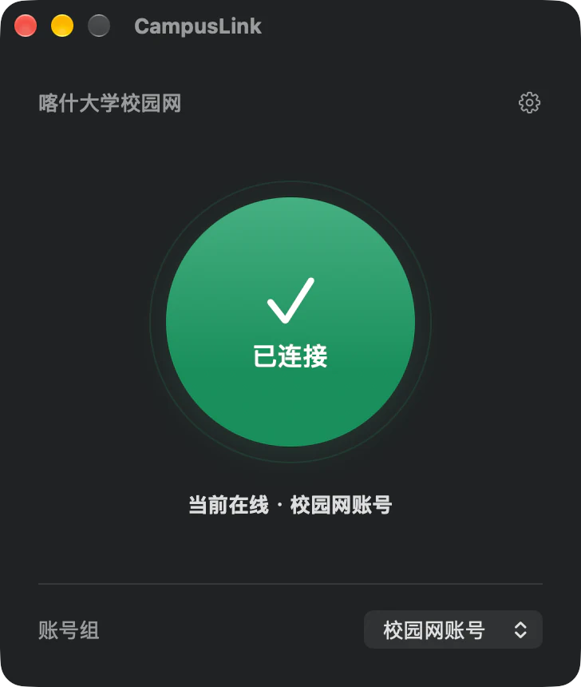
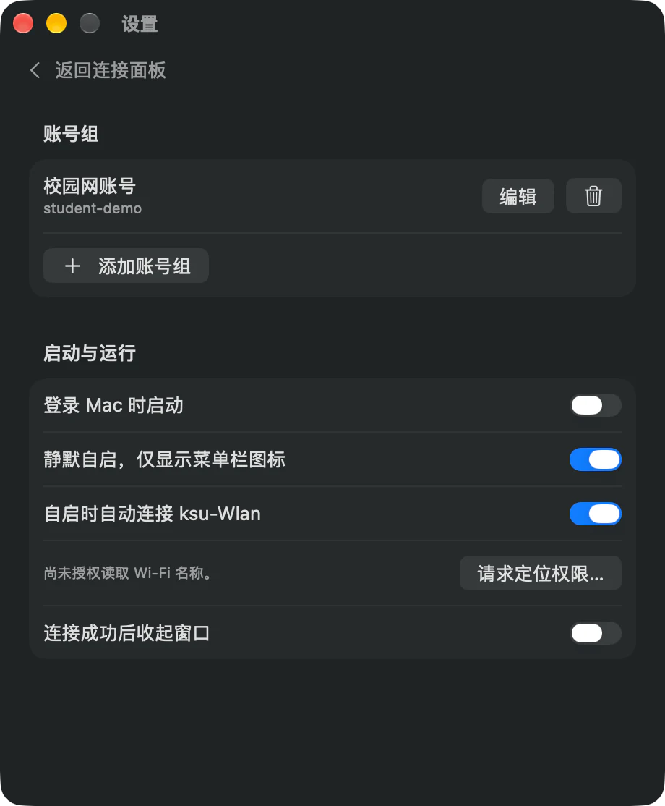

<h1 align="center">CampusLink</h1>

<strong>喀什大学校园网的非官方 macOS 客户端</strong>

  
  

  <a href="https://github.com/zhouycheng/CampusLink/releases/latest"><strong>下载 macOS 版（DMG）</strong></a>
   
  <a href="macOS/README.md">使用与构建</a> · <a href="LICENSE">MIT License</a>

## 安装和使用

支持 macOS 13 及以上，适用于 Apple Silicon 和 Intel Mac。下载 DMG 后，把 CampusLink 拖进「应用程序」。当前安装包未经过 Apple 公证。

连上校园 Wi-Fi 或网线，在设置里添加账号组，回到主窗口点「开始连接」。平时可以从菜单栏打开应用，也可以设置登录 Mac 时自动连接 `ksu-Wlan`。

本项目沿用上游 CampusLink 的认证流程，学校网关使用明文 HTTP 接收密码。[上游仓库](https://github.com/JiangfengPang/CampusLink) · [Windows 版下载](https://github.com/JiangfengPang/CampusLink/releases)
